<div align="center">


<a href="https://www.linkedin.com/in/chethan-gowda-s-n-abb165329/"></a>
<a href="mailto:iamchethan2813@gmail.com"></a>
<a href="https://github.com/chethangowda-web?tab=repositories"></a>


<a href="https://github.com/chethangowda-web"></a>

</div>

<br/>

<table>
<tr>
<td width="55%" valign="top">

### `$ whoami`

```yaml
name:      Chethan Gowda S N
role:      Computer Science Engineering student
base:      Bengaluru, India 🇮🇳
builds:    AI agents · RAG systems · full-stack apps
believes:  "understand the system, not just the framework"
seeking:   SWE / AI Engineering internship
```

I like the layer where **AI meets real software** — taking an idea through
`intent → logic → agents → data → validation → shipped product`
and making every hop reliable.

</td>
<td width="45%" valign="top">

### `$ cat now.txt`

🛰️ &nbsp;**Building** [Chakravyuh](https://github.com/chethangowda-web/Chakravyuh): red-teaming LLMs in Indian languages

🧠 &nbsp;**Studying** RAG guardrails, evals & system design

⚔️ &nbsp;**Grinding** DSA every single day

🏁 &nbsp;**Shipping** at hackathons, then polishing after

💬 &nbsp;**Ask me about** LangGraph, MCP, RAG, LLM security

⚡ &nbsp;**Fun fact:** 75+ repos and counting

</td>
</tr>
</table>

## `$ ./pipeline --explain`



## `$ ps aux --sort=-start_time`

<sub>🟢 = live demo &nbsp;·&nbsp; newest processes first</sub>

<table>
<tr>
<td width="50%" valign="top">

#### 🌀 [Chakravyuh](https://github.com/chethangowda-web/Chakravyuh) &nbsp;
<sub>`PID 001` · **Indic red-teaming lab for LLM & voice apps**</sub>

Attacks your AI app with native, romanized and code-mixed prompts in English, Hindi, Kannada, Telugu & Tamil, then auto-patches the system prompt and proves the fix on held-out attacks. Ships a runtime shield, a CI gate, a GitHub Action and a browser extension.
<sub>Built for *Build with Sarvam* · Security & Developer Tools track</sub>


</td>
<td width="50%" valign="top">

#### 📑 [CiteWise](https://github.com/chethangowda-web/citewise) &nbsp;[](https://citewise-oxb5.onrender.com/)
<sub>`PID 002` · **Secure RAG chatbot with guardrails**</sub>

Answers policy questions only when it can cite a document, and refuses otherwise. Hybrid pgvector + full-text retrieval with RRF, two-layer prompt-injection screening, PII redaction, an audit ledger, and a 44-question eval gate in CI.


</td>
</tr>
<tr>
<td width="50%" valign="top">

#### 🤖 [OmniPlus](https://github.com/chethangowda-web/OmniPlus)
<sub>`PID 003` · **MCP-powered local AI assistant**</sub>

A CLI and web dashboard that connects LLMs to your files, live web search and GitHub through the Model Context Protocol. Uses a LangGraph ReAct agent with multi-turn memory, SSE streaming and Groq ↔ Gemini failover.


</td>
<td width="50%" valign="top">

#### 🛰️ [ORBIT](https://github.com/chethangowda-web/ORBIT) &nbsp;[](https://orbit-lyart-tau-78.vercel.app)
<sub>`PID 004` · **Orchestrated Resource & Business Intelligence Taskmaster**</sub>

Natural-language task workflows driven by a supervisor that routes work to specialized agents, with a web dashboard and backend API.


</td>
</tr>
<tr>
<td width="50%" valign="top">

#### 🛡️ [SentinelRAG](https://github.com/chethangowda-web/SentinalRAG)
<sub>`PID 005` · **Self-correcting retrieval-augmented generation**</sub>

A 10-node LangGraph pipeline that scores confidence after every retrieval, rewrites weak queries, flags contradictions, and asks for clarification instead of hallucinating. Uses hybrid Qdrant + BM25 search with cross-encoder reranking.


</td>
<td width="50%" valign="top">

#### 🩺 [MedAssist AI](https://github.com/chethangowda-web/MedAssist-AI) &nbsp;[](https://med-assist-ai-chi.vercel.app)
<sub>`PID 006` · **Multi-agent healthcare copilot**</sub>

AI assistance for rural health workers, ASHA workers and primary-care providers.
🏆 *Grand Finale — AI Agent Builder Series 2026, Bengaluru*


</td>
</tr>
<tr>
<td width="50%" valign="top">

#### 🌾 [SwasthAI](https://github.com/chethangowda-web/SwasthAI)
<sub>`PID 007` · **Workforce intelligence for rural health**</sub>

Five AI agents handle attendance verification (GPS geofencing + selfie spoof checks), supervisor reports, smart scheduling, staffing-shortage prediction, and a health assistant in English, Hindi and Kannada.


</td>
<td width="50%" valign="top">

#### 🚨 [SentinelFlow AI](https://github.com/chethangowda-web/SentinalFlowAI-Hackathon) &nbsp;[](https://sentinal-flow-ai-hackathon-murex.vercel.app)
<sub>`PID 008` · **Autonomous incident response & post-mortem agent**</sub>

Multi-step agent reasoning that analyzes incidents and writes structured post-mortems.
🏆 *Round 2 — HiDevs × Mastra AI Agent Builder Hackathon*


</td>
</tr>
</table>

<details>
<summary><b>📂 &nbsp;more processes running in the background…</b></summary>
<br/>

| PID | Project | What it does |
|:---:|---|---|
| 009 | [TrafficMind AI](https://github.com/chethangowda-web/TrafficMindAI) | Night-traffic control room: a coordinator agent routing to analysis, route, incident & insight agents |
| 010 | [SARA](https://github.com/chethangowda-web/SARA) | AI-assisted grievance tracking, escalation & resolution workflows |
| 011 | [MedFlow AI](https://github.com/chethangowda-web/MedFlow-AI) | Hospital care-coordination agents: intake → risk → treatment → follow-up |
| 012 | [AI Engineer Roadmap](https://github.com/chethangowda-web/AI-engineer-roadmap) · [🟢 live](https://ai-engineer-roadmap-wine.vercel.app) | Progress tracker for a complete AI engineering roadmap |
| 013 | [SpendWise](https://github.com/chethangowda-web/SpendWise) · [🟢 live](https://spendwise-f6f3f.web.app/) | Expense tracking with spending reports & charts |
| 014 | [TruthChain](https://github.com/chethangowda-web/TruthChain) | Deepfake & misinformation detection with blockchain verification |
| 015 | [Silent Guardian](https://github.com/chethangowda-web/Silent-Guardian) | AI-powered personal safety intelligence system |
| 016 | [NeuroGuard](https://github.com/chethangowda-web/NeuroGuard) | Server-failure prediction using digital-twin intelligence |
| 017 | [CareAI](https://github.com/chethangowda-web/CareAI) | Software-based cognitive health monitoring |
| 018 | [DSA Mentor](https://github.com/chethangowda-web/Frontend-Project-DSA-Mentor) | AI-powered DSA learning platform: understand, don't memorize |
| 019 | [70-Day DSA Sheet](https://github.com/chethangowda-web/Chethan-s-DSA-Sheet) | A focused interview-prep path through DSA |
| 020 | [Concurrent Task Manager](https://github.com/chethangowda-web/Concurrent-Task-Manager) | Java multithreading, OOP & collections in a real system |

</details>

## `$ top`


## `$ apt list --installed`

<div align="center">

<sub>**LANGUAGES**</sub><br/>


<sub>**FRAMEWORKS & BACKEND**</sub><br/>


<sub>**DATA & TOOLING**</sub><br/>


<sub>**AI ENGINEERING**</sub><br/>


</div>

## `$ tail -f /var/log/achievements.log`

```diff
+ [2026] 🏆 GRAND FINALE   AI Agent Builder Series 2026 · MedAssist-AI · Bengaluru
+ [2026] 🥈 ROUND 2        HiDevs × Mastra AI Agent Builder Hackathon · SentinelFlow AI
+ [2026] 🤝 TOP 25         Volunteer recognition · AI Agent Builder Series 2026
! [NOW ] ⏳ IN PROGRESS    next hackathon, next build, next milestone...
```

## `$ git log --graph --all`

<div align="center">


<picture>
  <source media="(prefers-color-scheme: dark)" srcset="https://raw.githubusercontent.com/chethangowda-web/chethangowda-web/output/github-snake-dark.svg"/>
  <source media="(prefers-color-scheme: light)" srcset="https://raw.githubusercontent.com/chethangowda-web/chethangowda-web/output/github-snake.svg"/>
  
</picture>

</div>

<br/>


