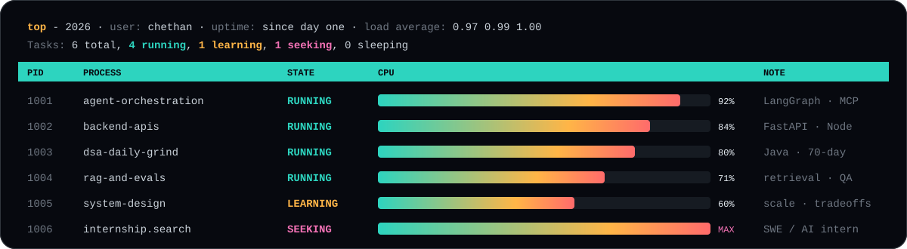

<div align="center">



<a href="https://www.linkedin.com/in/chethan-gowda-s-n-abb165329/"></a>
<a href="mailto:iamchethan2813@gmail.com"></a>
<a href="https://github.com/chethangowda-web?tab=repositories"></a>


<a href="https://github.com/chethangowda-web"></a>

</div>

<br/>

<table>
<tr>
<td width="55%" valign="top">

### `$ whoami`

```yaml
name:      Chethan Gowda S N
role:      Computer Science Engineering student
base:      Bengaluru, India 🇮🇳
builds:    AI agents · RAG systems · full-stack apps
believes:  "understand the system, not just the framework"
seeking:   SWE / AI Engineering internship
```

I like the layer where **AI meets real software** — taking an idea through
`intent → logic → agents → data → validation → shipped product`
and making every hop reliable.

</td>
<td width="45%" valign="top">

### `$ cat now.txt`

🛰️ &nbsp;**Building** multi-agent workflows that do real work

🧠 &nbsp;**Studying** RAG, evaluation & system design

⚔️ &nbsp;**Grinding** DSA every single day

🏁 &nbsp;**Shipping** at hackathons, then polishing after

💬 &nbsp;**Ask me about** LangGraph, FastAPI, agent design

⚡ &nbsp;**Fun fact:** 75+ repos and counting

</td>
</tr>
</table>

## `$ ./pipeline --explain`


## `$ ps aux --sort=-impact`

<table>
<tr>
<td width="50%" valign="top">

#### 🛰️ [ORBIT](https://github.com/chethangowda-web/ORBIT)
<sub>`PID 001` · **Orchestrated Resource & Business Intelligence Taskmaster**</sub>

Natural-language task workflows driven by a supervisor that routes work to specialized agents, with a web dashboard and backend API.


</td>
<td width="50%" valign="top">

#### 🚨 [SentinelFlow AI](https://github.com/chethangowda-web/SentinalFlowAI-Hackathon)
<sub>`PID 002` · **Autonomous Incident Response & Post-Mortem Agent**</sub>

Multi-step agent reasoning that analyzes incidents and writes structured post-mortems.
🏆 *Round 2 — HiDevs × Mastra AI Agent Builder Hackathon*


</td>
</tr>
<tr>
<td width="50%" valign="top">

#### 🩺 [MedAssist AI](https://github.com/chethangowda-web/MedAssist-AI)
<sub>`PID 003` · **Multi-agent healthcare copilot**</sub>

AI assistance for rural health workers, ASHA workers and primary-care providers.
🏆 *Grand Finale — AI Agent Builder Series 2026, Bengaluru*


</td>
<td width="50%" valign="top">

#### ⚖️ [SARA](https://github.com/chethangowda-web/SARA)
<sub>`PID 004` · **Smart Accountability & Resolution Assistant**</sub>

AI-assisted grievance workflows: tracking, escalation, prioritization and resolution visibility.


</td>
</tr>
<tr>
<td width="50%" valign="top">

#### 🏥 [MedFlow AI](https://github.com/chethangowda-web/MedFlow-AI)
<sub>`PID 005` · **Hospital care-coordination agents**</sub>

Specialized agents for intake, history, risk assessment, treatment planning and follow-up.


</td>
<td width="50%" valign="top">

#### 🔗 [TruthChain](https://github.com/chethangowda-web/TruthChain)
<sub>`PID 006` · **Deepfake & misinformation detection**</sub>

AI-powered detection of manipulated media, combined with blockchain-backed verification.


</td>
</tr>
</table>

<details>
<summary><b>📂 &nbsp;more processes running in the background…</b></summary>
<br/>

| PID | Project | What it does |
|:---:|---|---|
| 007 | [Silent Guardian](https://github.com/chethangowda-web/Silent-Guardian) | AI-powered personal safety intelligence system |
| 008 | [NeuroGuard](https://github.com/chethangowda-web/NeuroGuard) | Server-failure prediction using digital-twin intelligence |
| 009 | [CareAI](https://github.com/chethangowda-web/CareAI) | Software-based cognitive health monitoring |
| 010 | [SpendWise](https://github.com/chethangowda-web/SpendWise) | Expense tracking with spending reports & charts |
| 011 | [DSA Mentor](https://github.com/chethangowda-web/Frontend-Project-DSA-Mentor) | AI-powered DSA learning platform — understand, don't memorize |
| 012 | [70-Day DSA Sheet](https://github.com/chethangowda-web/Chethan-s-DSA-Sheet) | A focused interview-prep path through DSA |
| 013 | [Concurrent Task Manager](https://github.com/chethangowda-web/Concurrent-Task-Manager) | Java multithreading, OOP & collections in a real system |
| 014 | [30 Days Frontend](https://github.com/chethangowda-web/30-Days-Frontend) | 30 days, 30 different frontend builds |

</details>

## `$ top`



## `$ apt list --installed`

<div align="center">

<sub>**LANGUAGES**</sub><br/>


<sub>**FRAMEWORKS & BACKEND**</sub><br/>


<sub>**DATA & TOOLING**</sub><br/>


<sub>**AI ENGINEERING**</sub><br/>


</div>

## `$ tail -f /var/log/achievements.log`

```diff
+ [2026] 🏆 GRAND FINALE   AI Agent Builder Series 2026 · MedAssist-AI · Bengaluru
+ [2026] 🥈 ROUND 2        HiDevs × Mastra AI Agent Builder Hackathon · SentinelFlow AI
+ [2026] 🤝 TOP 25         Volunteer recognition · AI Agent Builder Series 2026
! [NOW ] ⏳ IN PROGRESS    next hackathon, next build, next milestone...
```

## `$ git log --graph --all`

<div align="center">


<picture>
  <source media="(prefers-color-scheme: dark)" srcset="https://raw.githubusercontent.com/chethangowda-web/chethangowda-web/output/github-snake-dark.svg"/>
  <source media="(prefers-color-scheme: light)" srcset="https://raw.githubusercontent.com/chethangowda-web/chethangowda-web/output/github-snake.svg"/>
  
</picture>

</div>

<br/>


